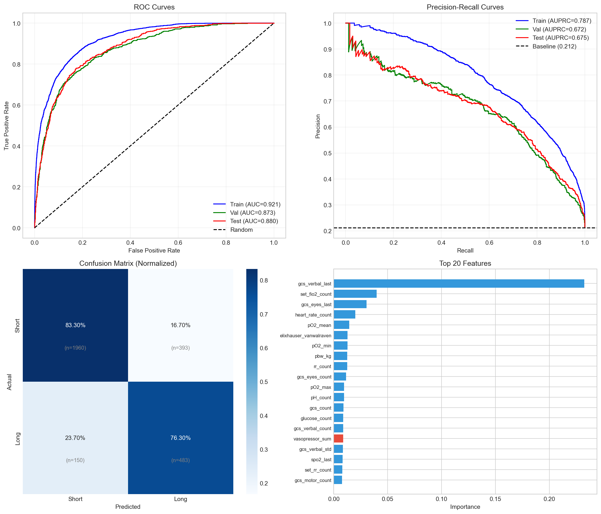
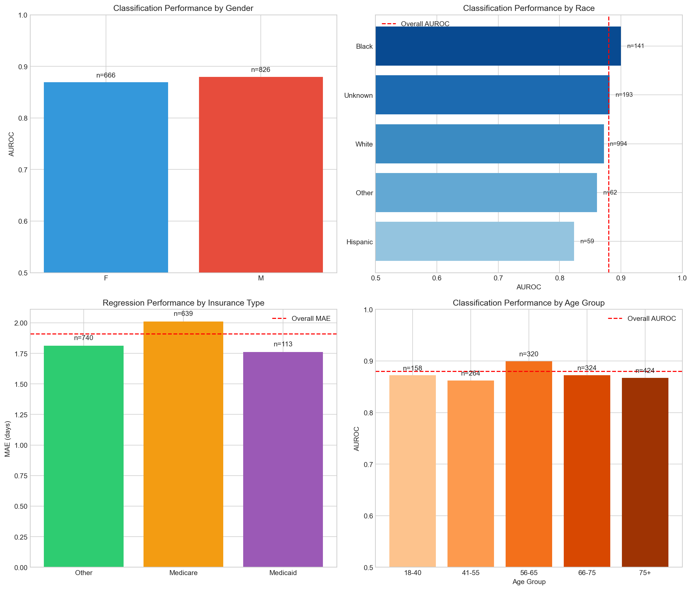
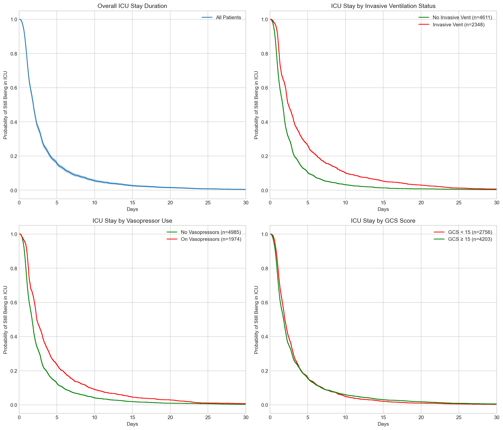

# ICU length-of-stay prediction on MIMIC-IV

Predicting, from the first 24 hours of an ICU stay, whether an adult patient will stay 4 days or longer, and how long the stay will last. The project compares gradient boosting, a Cox survival model and sequence models (LSTM, GRU, Transformer) on hourly ICU data, and checks whether the classifier performs equally well across gender, race, age and insurance groups.

**No patient data, derived data or trained model weights are in this repository.** The data is credentialed and must be obtained from PhysioNet (see [Data](#data)). Notebook outputs have been cleared for the same reason. The figures below show aggregate results only.

## Results

A sample of 20,000 patients, filtered to adults with at least 4 hours of ICU data. Features come from the first 24 hours. About 21% of stays last 4 days or longer.

| Task | Model | Test result |
|---|---|---|
| Long stay (≥ 4 days) | XGBoost on aggregated 24 h features | AUROC **0.880**, AUPRC 0.675 (base rate 0.21) |
| Long stay (≥ 4 days) | Transformer on hourly sequences | AUROC 0.842, AUPRC 0.621 |
| Long stay (≥ 4 days) | GRU / LSTM on hourly sequences | AUROC 0.83–0.84, AUPRC 0.59–0.62 |
| Length of stay (days) | XGBoost regression | MAE **1.91 days**, R² 0.275 |
| Time to ICU discharge | Cox proportional hazards | C-index **0.75** |

The sequence models use their own preprocessing and split (`06_dl_preprocessing.py`), so compare them with the XGBoost numbers with some care.

Findings:

- The last verbal Glasgow Coma Scale score is by far the strongest predictor, in both the classifier and the regressor.
- Gradient boosting on simple 24-hour aggregates did better than the sequence models in these runs.
- Regression error grows with the length of the stay: about 1 day of error for stays under 2 days, about 15 days for stays over 14 days.
- **Fairness:** AUROC was similar for women and men (≈0.87 vs 0.88) and across age groups (0.86–0.90). By race it ranged from 0.82 (Hispanic, n = 59) to 0.90 (Black, n = 141), with the lowest values in the smallest groups. Regression MAE by insurance type ranged from 1.76 to 2.01 days.







## Pipeline

The `.py` files are percent-format notebooks (`# %%` cells). Run them as scripts, or open them as notebooks in VS Code or Jupyter.

| Step | File | What it does |
|---|---|---|
| 1 | `notebooks/01_data_exploration.py` | Loads the per-patient files; checks distributions and missingness |
| 2 | `notebooks/02_preprocessing.py` | Cohort criteria, static features, first-24 h aggregates, train/val/test split |
| 3 | `notebooks/03_xgboost_classification.py` | XGBoost classifier for long stays, with a grid search |
| 4 | `notebooks/04_survival_analysis.py` | Kaplan-Meier curves, Cox model, hazard ratios, C-index |
| 5 | `notebooks/05_xgboost_regression.py` | XGBoost regression of length of stay |
| 6 | `notebooks/06_dl_preprocessing.py` | Hourly 24-step sequences for the deep models |
| 7 | `notebooks/07_fairness_analysis.py` | Performance by gender, race, insurance and age |
| 8 | `notebooks/07_transformer_models_classific.ipynb`, `08_transformers_regression.ipynb` | Transformer classifier and regressor |
| 9 | `notebooks/09_lstm_gru.ipynb`, `10_lstm_gru_classific.ipynb` | LSTM and GRU models, tuned with Optuna (best settings in `models/`) |

`02a_preprocessing50k.py` and `dl_preprocessingall.ipynb` are variants for the full 50,920-patient dataset. Figures are written to `outputs/` and `plots/`.

## Data

The data is **A Temporal Dataset for Respiratory Support in Critically Ill Patients** (v1.1.0), derived from MIMIC-IV v2.2. It is available on PhysioNet to credentialed users who sign the PhysioNet Credentialed Health Data Use Agreement 1.5.0.

1. Get credentialed access on [PhysioNet](https://physionet.org/content/temporal-respiratory-support/).
2. Download the dataset into `data/temporal-respiratory-support/`. The folder is gitignored.
3. Install the dependencies and run the steps from inside `notebooks/` (paths are relative):

```bash
python -m venv .venv && source .venv/bin/activate
pip install -r requirements.txt
cd notebooks && python 02_preprocessing.py
```

Please don't commit the data, derived files (`outputs/*.npz`, `*.pkl`, `*.csv`) or trained weights (`models/*.pt`). PhysioNet treats derived data and models as sensitive.

## Team

Course project (MSc, 2025–26) by **Elisa D'Errico** and **Suparna Biswas**.

- Elisa D'Errico: data exploration, preprocessing and cohort definition, XGBoost classification and regression, survival analysis, sequence preprocessing, fairness analysis.
- Suparna Biswas: Transformer, LSTM and GRU models with hyperparameter tuning, full-dataset preprocessing variants.

## Citations

- Moukheiber, M., Moukheiber, L., Moukheiber, D., Hao, S., Celi, L. A., & Lee, H. (2025). A Temporal Dataset for Respiratory Support in Critically Ill Patients (version 1.1.0). PhysioNet. https://doi.org/10.13026/wewp-sj67
- Moukheiber, M., Moukheiber, L., Moukheiber, D., & Lee, H. C. Unmasking Societal Biases in Respiratory Support for ICU Patients through Social Determinants of Health. arXiv:2502.16477. https://arxiv.org/abs/2502.16477
- Pollard, T., Moody, B. E., Lehman, L., Gow, B., Fernandes, C., Xie, C., Johnson, A., Mark, R. G., & Heldt, T. (2026). PhysioNet as a global platform for biomedical research. *Nature Health*. https://doi.org/10.1038/s44360-026-00096-z
- Johnson, A. E. W., et al. (2023). MIMIC-IV, a freely accessible electronic health record dataset. *Scientific Data*, 10, 1.
